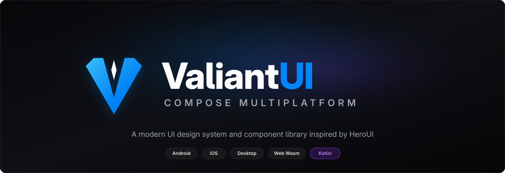

# ValiantUI Compose

  <picture>
    <source media="(prefers-color-scheme: dark)" srcset="assets/images/banner-dark.png">
    <source media="(prefers-color-scheme: light)" srcset="assets/images/banner-light.png">
    
  </picture>

  <strong>A modern UI design system and component library for Compose Multiplatform, inspired by <a href="https://heroui.com/">HeroUI</a>.</strong>

  
  
  

---

## Overview

**ValiantUI Compose** brings the aesthetics, ergonomics, and micro-interactions of HeroUI (formerly NextUI) to the **Compose Multiplatform** ecosystem.

It provides a cohesive set of accessible, highly customizable UI components targeting **Android**, **Desktop (JVM)**, **Web (WebAssembly & JS)**, and **iOS** from a single shared Kotlin codebase.

!!! note "Disclaimer"
    ValiantUI Compose is an independent, community-driven project. It is not affiliated with, maintained, sponsored, or endorsed by HeroUI Inc.

---

## Key Features

- **Comprehensive Token System**: Semantic color system with seamless Light and Dark mode switching.
- **Physics-Based Micro-Interactions**: Spring-driven press scaling (`pressScale` 0.97f) and native pointer cursor adaptations across platforms.
- **Multiplatform Consistency**: Identical declarative APIs and visual fidelity across mobile, desktop, and web.
- **Slot-Driven Composition**: Components are designed with composable slots (`startContent`, `endContent`, `label`, etc.) for flexible composition.
- **Compose UI Test Coverage**: Component dimensions, semantics, and interactive states are verified with automated UI test suites.

---

## Next Steps

- Review the [Installation & Setup](getting-started.md) guide and project status.
- Explore the [Theme & Colors](tokens/theme-and-colors.md) system.
- Browse available components: [Button](components/button.md), [Button Group](components/button-group.md), [Separator](components/separator.md), and [Spinner](components/spinner.md).
